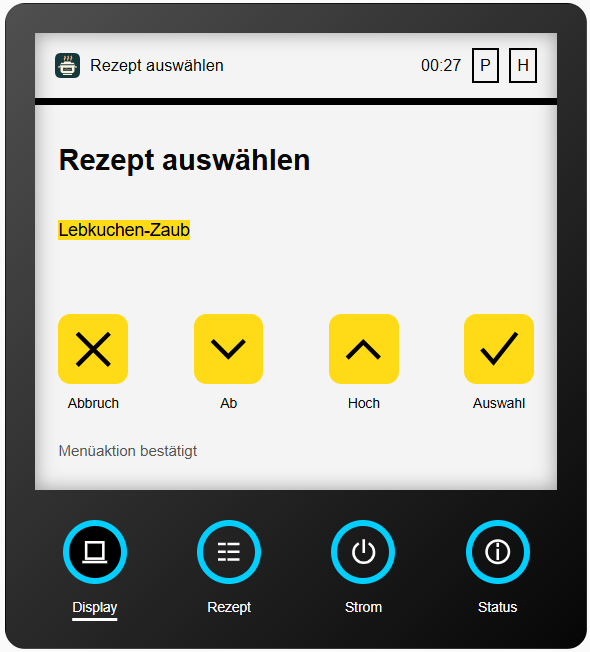

# Milestone: local recipe upload confirmed on hardware

On 15 November 2026 (Europe/Berlin), a user-operated test completed the path
**HBAC 0.3.0 → Home Assistant → Braumeister Bridge → Braumeister**.

Tested versions: integration 3.2.1-beta.5 and Bridge 0.5.1-beta.3.
HBAC was the test client; the HA actions and Bridge contract have no HBAC dependency.

## Observed results

1. The first readiness request reported a fresh connection, pump/heater off and
   uploads enabled, but `main_menu: false`. Upload readiness was correctly false
   with `device_not_idle`; no upload was submitted.
2. After the user returned the BM to its main menu, readiness became true with
   an empty blocking-reason list.
3. The user explicitly invoked the client with `--replace-all`, submitting one
   recipe. The response reported:

   ```json
   {"result":"confirmed","recipes":1,"written":1,"content_verification":"matched"}
   ```

4. The supplied dashboard screenshot shows `Lebkuchen-Zaub` in recipe selection.



This evidence consists of the user's pasted client output and screenshot; it is
not an independently captured device trace. The matching readback confirms the
encoded controller program, not the complete source recipe: ingredient amounts,
non-hop additions, fermentation and water chemistry are not device upload fields.
The previous recipe list was replaced. No brew-program start was requested.

## Scope and remaining tests

This establishes a successful single-recipe upload with fresh matching readback
and an idle-menu readiness check on the user's existing BM installation. It does
not establish WAN-blocked operation for this run, all controller compatibility,
multi-recipe replacement, power-loss recovery, or concurrent-client behavior on
hardware. Automated core/HA tests cover additional simulated conditions.

The software release remains a beta. The integration's existing local-mode and
navigation fixes are retained; the generic upstream proposal is separate from
the fork release and the HBAC client.
